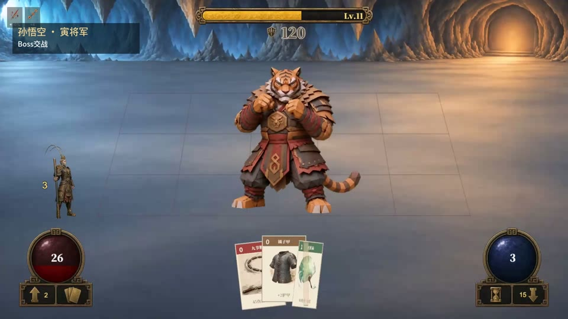
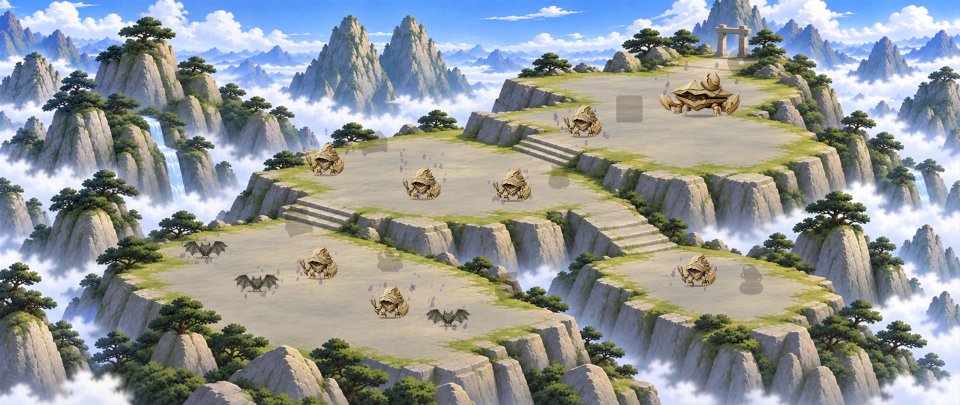
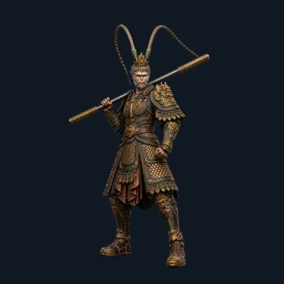
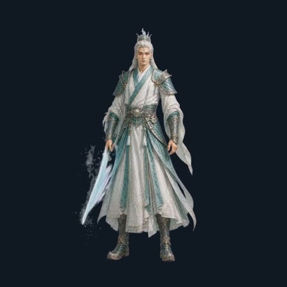

# 万界长卷 · Yijuanwanjie

《万界长卷》是一款国风回合制卡牌 Roguelite。你扮演执卷人，与西游英灵同行，在受侵蚀的河洛卷中探路、战斗，逐步构筑牌组。

[](https://github.com/manibookmark/Yijuanwanjie/releases/download/v2026.11.25/WanjieScroll-Opening-CG.mp4)

[观看开场 CG（3 分 32 秒）](https://github.com/manibookmark/Yijuanwanjie/releases/download/v2026.11.25/WanjieScroll-Opening-CG.mp4) · [Windows 游玩](#windows-游玩)

目前做了三个主关卡 **双叉岭、鹰愁涧、高老庄**。花果山是上手教程。

## 核心玩法

- **回合制战斗。** 观察敌人意图，分配有限的灵力，决定出牌顺序。
- **叠势与相生。** 按费用逐张加 1，可以接续数字叠势并强化相关牌效。也可以利用五行相生组织连锁。
- **探索与构筑。** 选择路线，经历战斗和地图事件，用新卡、灵印和英灵能力调整牌组，再迎战关底首领。

| 孙悟空对战寅将军 | 卷中关卡 |
| --- | --- |
|  |  |

## 英灵登场

点击下方预览，观看从游戏资源导出的首次登场动画。

| 孙悟空 | 唐三藏 | 白龙马 |
| --- | --- | --- |
| [](https://github.com/manibookmark/Yijuanwanjie/releases/download/v2026.11.25/WanjieScroll-Wukong-Entrance.mp4) | [](https://github.com/manibookmark/Yijuanwanjie/releases/download/v2026.11.25/WanjieScroll-Tang-Sanzang-Entrance.mp4) | [](https://github.com/manibookmark/Yijuanwanjie/releases/download/v2026.11.25/WanjieScroll-Bai-Longma-Entrance.mp4) |

## Windows 游玩

克隆仓库后，双击 `Play.cmd` 或在仓库目录运行下面的命令。首次启动会从 GitHub Release 下载并校验 Windows x64 玩家包，文件缓存于当前用户的本地应用数据目录。以后可以复用缓存。玩家版无需安装编辑器。

```powershell
powershell -NoProfile -ExecutionPolicy Bypass -File .\Play.ps1
```

玩家包和素材包发布在 [版本下载页](https://github.com/manibookmark/Yijuanwanjie/releases/tag/v2026.11.25)。使用启动脚本即可自动下载、校验并合并分卷。

## 从源码运行

1. 安装团结引擎 1.10.2（`2022.3.62t14`）。
2. 在克隆目录中运行下列命令。脚本会下载并校验游戏素材，导入官方 TextMesh Pro Essentials，然后打开正式的 Loading 场景。
3. 等待导入完成，在团结引擎内按 Play。修改 `ContentSource/cards/` 后通过菜单「万界长卷 / 内容 / 生成运行时内容包」重新生成运行包。

```powershell
powershell -NoProfile -ExecutionPolicy Bypass -File .\Setup-Project.ps1 -OpenEditor
```

离线时可通过 `-AssetArchivePath` 和 `-RuntimeMediaArchivePath` 指定已下载的同版完整资源 ZIP。若已安装的引擎不在脚本的发现路径中，通过 `-EditorPath` 指定 `Tuanjie.exe`。要从源码构建 Windows x64 玩家版，安装对应构建支持，并在命令行传入 `-batchmode -nographics -quit -projectPath <仓库路径> -executeMethod WanjieScroll.EditorTools.PublicPlayerBuilder.BuildWindows`。输出目录为 `Builds/Public`。

## 源码与素材

- `Assets/Scenes/`、`Assets/Prefabs/`、`Assets/Scripts/` 提供正式游戏场景、预制件与源码。
- `ContentSource/cards/` 是卡牌、敌人等内容的作者源，`Assets/Resources/Content/Generated/` 是生成后的运行时包。
- 美术、音频、字体和视频以原始运行格式随同版本 Release 发布。素材及校验值逐项列在 `runtime-media.manifest.json` 和 `external-assets.manifest.json`。脚本将它们恢复到原始路径，Git 中的 `.meta` 保留引擎资源身份。

软件源码和内容配置采用 [MIT](LICENSE)。项目自有游戏美术、音乐、音效、配音和视频采用 CC BY 4.0。字体遵循上游许可，团结引擎及其下载依赖有独立许可。详见 [素材与依赖许可](ASSET-LICENSES.md)。
